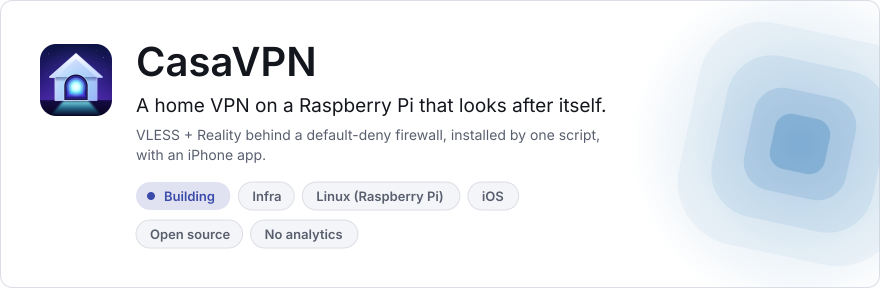
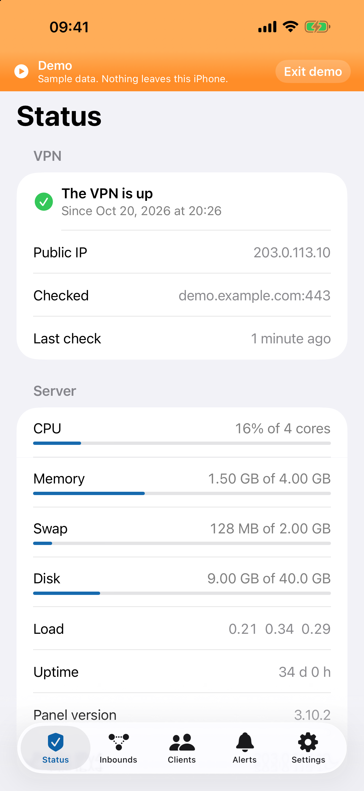
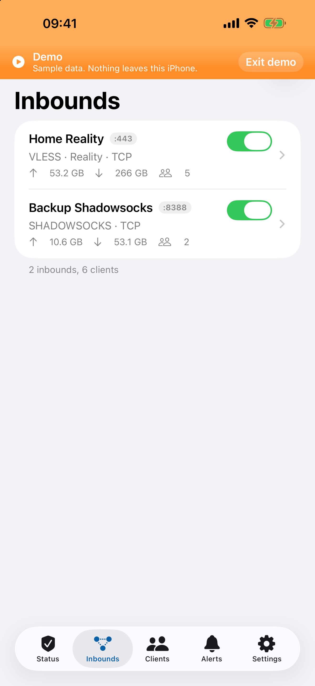
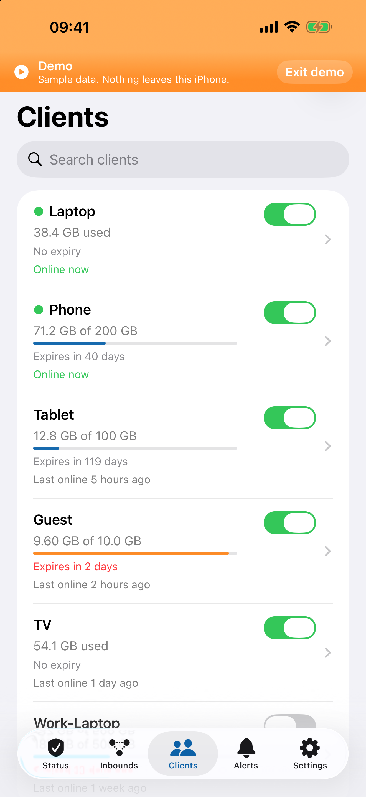
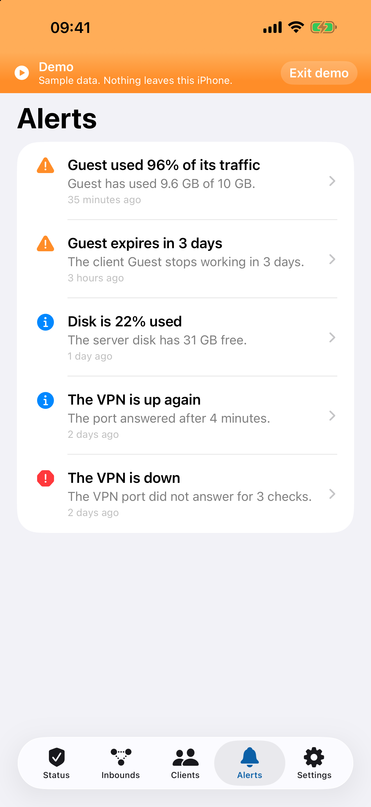
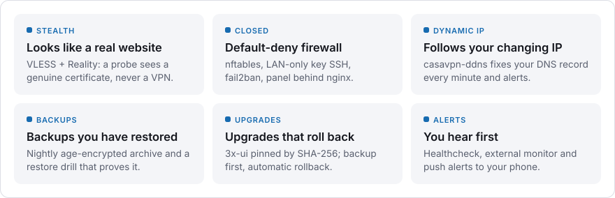
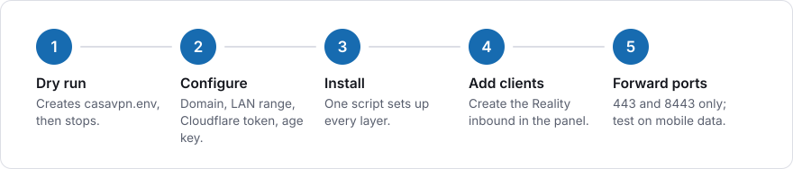
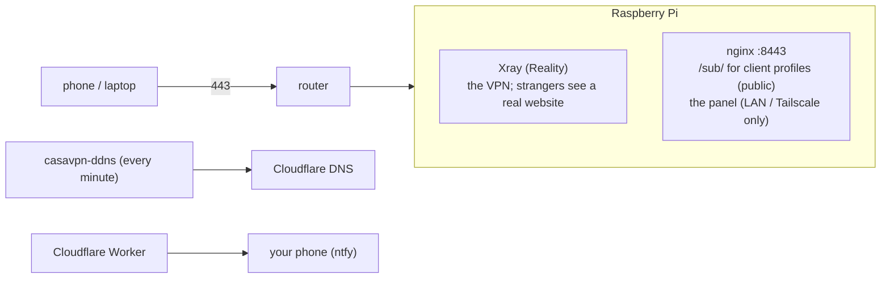

<!-- Pictures: docs/readme/spec.json, drawn by readme-kit. Do not edit the SVGs by hand. -->
<picture><source media="(prefers-color-scheme: dark)" srcset="docs/readme/hero-dark.svg"></picture>

**Rebuild your whole VPN in an afternoon: one script installs the server, firewall, backups and monitoring.**

CasaVPN runs VLESS + Reality (3x-ui / Xray) on a Raspberry Pi, with a dynamic-IP updater, an external monitor and an iPhone app. It is for people who run a server at home and want to hear about problems first.

[Quick start](docs/QUICKSTART.md) · [iPhone app](app/README.md) · [Changelog](CHANGELOG.md) · [Docs](#docs)

> **Status.** The iPhone app is 1.0.0 (build 2), on TestFlight only; it is not on the App
> Store and no App Store submission is open ([docs/APP-STORE.md](docs/APP-STORE.md)). The server kit has no
> tagged release yet; its changes are under "Unreleased" in the [CHANGELOG](CHANGELOG.md).
> Every script is covered by offline tests with fake system tools. `install.sh` has **not**
> yet been run end to end on a clean Raspberry Pi. Do your first install with the Pi in
> reach, and read the CHANGELOG for what is verified and what is not.

<p align="center">




</p>

## What it does

<picture><source media="(prefers-color-scheme: dark)" srcset="docs/readme/highlights-dark.svg"></picture>

- **Panel access.** The panel stays on loopback behind nginx: reachable from LAN, Tailscale or one VPN identity.
- **Four IP sources.** `casavpn-ddns` reads the record back after each change.
- **Certificates without port 80.** Let's Encrypt by DNS-01 through Cloudflare.
- **Minimum client version.** Re-asserted after every upgrade.
- **Safe defaults.** VPN clients cannot reach your LAN; BitTorrent is blocked; the healthcheck fails if either rule disappears.
- **Healthcheck.** `casavpn-healthcheck` runs on the host and remotely; an external Cloudflare Worker watches from outside; ntfy pushes.
- **Tested without a Pi.** About 480 offline test assertions, shellcheck-clean, plus a scanner that keeps personal data out of the repository.
- **iPhone app.** Five tabs: Status (Xray controls and log), Inbounds, Clients (share links with QR), Alerts and Settings. It has a demo mode and no analytics. See [app/](app/README.md) and [docs/APP.md](docs/APP.md).

## How it works

<picture><source media="(prefers-color-scheme: dark)" srcset="docs/readme/steps-dark.svg"></picture>



## Quick start

```bash
git clone <REPO_URL> casavpn && cd casavpn      # on the Pi, as a sudo-capable user with an SSH key
sudo ./install.sh --dry-run                     # 1. creates /etc/casavpn/casavpn.env, then stops
sudo nano /etc/casavpn/casavpn.env              # 2. domain, LAN range, Cloudflare token, age public key
sudo ./install.sh                               # 3. installs; prints the one panel step left for you
# 4. create the Reality inbound + clients in the panel as printed, then: sudo casavpn-minver
# 5. forward ONLY the VPN port (443) and the web port (8443) on your router, test from mobile data
```

First-run check: `sudo casavpn-healthcheck --local`. The long version, with prerequisites: [docs/QUICKSTART.md](docs/QUICKSTART.md).

## Requirements

- A Raspberry Pi 4/5 (or any Debian 12+/Ubuntu 22.04+ host, arm64 or amd64) on a wired connection
- A **public IPv4 address** (not CGNAT) and a router where you can forward two TCP ports
- A domain whose DNS is on Cloudflare (free plan) and a DNS-edit API token for that zone
- A laptop with `ssh`; `age` for backups; optionally Tailscale and an [ntfy](https://ntfy.sh) topic

Not for you if you only need a quick VPN on a network that does not block VPNs
(plain WireGuard is simpler), or if your line is CGNAT or IPv6-only ([FAQ](docs/FAQ.md)).

<details>
<summary>Commands (on the Pi and on your laptop)</summary>

| On the Pi | |
|---|---|
| `casavpn-healthcheck --local` | verify every layer |
| `casavpn-ddns [--check\|--force]` | DNS record vs public IP |
| `casavpn-backup` | encrypted backup now |
| `casavpn-minver [--check]` | set / verify the minimum client version |
| `casavpn-upgrade` / `casavpn-rollback` | move 3x-ui to the pinned release / undo it |
| `casavpn-alerts [--dry-run]` | one pass of host alerts (certificate, traffic, backups, disk, reboot) to the relay and ntfy; a timer runs it every 15 minutes |
| `casavpn-pair [--yes]` | print the pairing link and QR code for the iPhone app |
| `casavpn-os-upgrade [--dry-run] [--no-reboot]` | the monthly OS upgrade with a reboot and a post-check; a timer runs it |

| On your laptop | |
|---|---|
| `scripts/healthcheck.sh` | the same checks from outside |
| `scripts/gen-client-links.sh` | client links from the live database |
| `scripts/pull-backups.sh`, `scripts/restore-drill.sh` | fetch backups, prove they restore |
| `scripts/cf-api.sh`, `scripts/dns-diff.sh` | Cloudflare helper, DNS migration checks |
| `./check.sh` | shellcheck, tests, personal-data scan (the gate; there is no CI) |

</details>

<details>
<summary>Repository layout</summary>

```
install.sh              the installer (--dry-run, --show <config>, --skip-<step>)
casavpn.env.example     every setting, documented
scripts/                tools installed to /usr/local/bin, and laptop-side helpers (scripts/lib/ shared code)
config/                 templates: nftables, nginx, sshd, fail2ban, systemd, launchd, DNS examples, 3x-ui pin
app/                    the iPhone app (SwiftUI) and its store listing text
monitor/                the external uptime monitor and the app's alert relay (Cloudflare Worker, TypeScript)
tests/                  offline tests with fake systemctl/nft/sshd/dig/curl on PATH
tools/                  the personal-data scanner
docs/                   the manual
check.sh                the local gate
```

</details>

## Docs

| Document | What is in it |
|---|---|
| [Quick start](docs/QUICKSTART.md) | Install, step by step, with prerequisites |
| [Architecture](docs/ARCHITECTURE.md) | How the parts fit together |
| [Hardening and panel access](docs/HARDENING.md) | Firewall, SSH, panel exposure |
| [Security model](docs/SECURITY-MODEL.md) | What is protected, and from whom |
| [iPhone app](docs/APP.md) | The app's design and the relay API |
| [App Store](docs/APP-STORE.md) | How the app reaches the App Store; review checklist |
| [Clients](docs/CLIENTS.md) | Creating identities and connecting a device |
| [Dynamic IP](docs/DYNAMIC-IP.md) | The DNS updater |
| [Backup and restore](docs/BACKUP.md) | Encrypted backups and the restore drill |
| [Upgrading](docs/UPGRADING.md) | Pinned 3x-ui, upgrade and rollback |
| [Monitoring](docs/MONITORING.md) | Healthcheck, external monitor, alerts |
| [DNS migration](docs/DNS-MIGRATION.md) | Moving DNS to Cloudflare |
| [Reality target](docs/REALITY-TARGET.md) | Choosing the site Reality imitates |
| [Runbook](docs/RUNBOOK.md) | What to do when something breaks |
| [FAQ](docs/FAQ.md) | Common questions and limits |
| [Legal](docs/LEGAL.md) | Responsible use and what to think about first |

## Responsible use

You are the operator: traffic leaves from your IP address. Read
[docs/LEGAL.md](docs/LEGAL.md) and [docs/SECURITY-MODEL.md](docs/SECURITY-MODEL.md)
before you invite anyone.

## License

MIT, see [LICENSE](LICENSE). 3x-ui and Xray are separate projects under their own licenses.

<!-- teyla:reviewed 2026-11-13 -->
